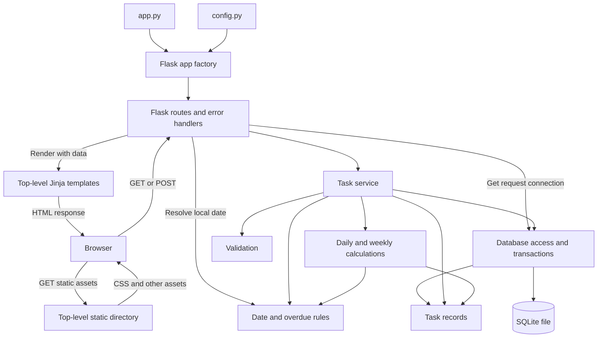
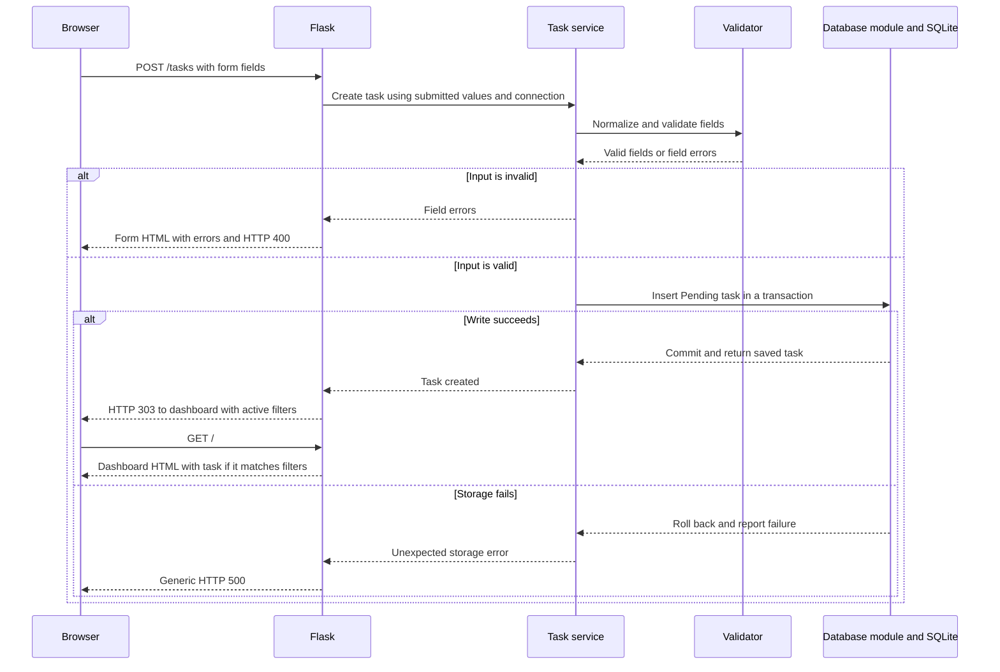
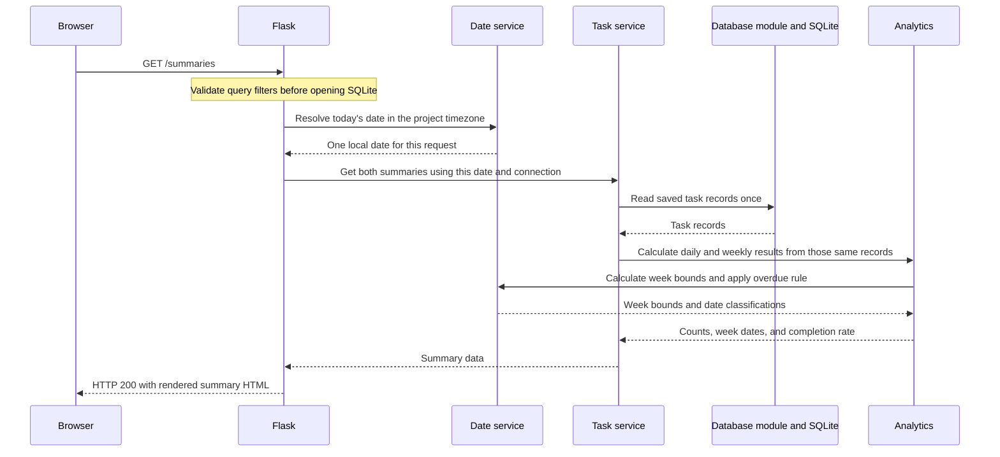

# DayPlan architecture

Daily Task and Reminder Manager · Approved Phase 2 baseline, implementation updated for Phase 3.2H

The [project specification](PROJECT_SPECIFICATION.md) defines the approved product behavior. This document describes the architecture in the current checkout.

| Status | Decisions |
|---|---|
| Implemented | The Flask factory registers the dashboard, task actions, summaries, health, error handlers, and the database CLI. SQLite persistence, server-side validation, date rules, analytics, Jinja views, and pytest coverage are in place. |
| Confirmed direction | Use Python 3.13, Flask, Jinja2, HTML/CSS, SQLite, pytest, and GitHub Actions. Preserve one app factory and the top-level `templates/` and `static/` directories. Keep task rules and authoritative date and summary calculations on the server. |
| Release verification | The GitHub Actions workflow is present. Live PR checks and branch protection still need verification. The baseline is a local demo, with Render as an optional hosting path. |

## 1. System architecture

DayPlan is a single Flask application. The browser submits ordinary HTML forms and receives HTML rendered with Jinja. Flask routes translate HTTP requests into service calls. Services coordinate task operations, and the persistence module is the only place that executes SQL. SQLite stores the task records in one file.

## 2. Startup and configuration

1. Flask or the deployment server imports `app.py`. It calls `create_app()` and exposes the returned application. Tests call the same factory with `TestingConfig`.
2. The factory builds the app, sets absolute paths to the existing top-level `templates/` and `static/`, loads the configuration, and registers routes and error handlers.
3. `config.py` defines `TIMEZONE` as `Asia/Kolkata`. The date service resolves the local date with `ZoneInfo` and the required `tzdata` dependency. The factory resolves `DATABASE_PATH` from an explicit config value, the environment, or the default `instance/dayplan.sqlite3`, in that order. An explicitly blank path is rejected. Tests set up isolated temporary database files.
4. The factory resolves `SECRET_KEY` from an explicit config value or the environment and rejects a missing or blank key at startup. Local development and optional deployment use separately configured environment secrets. Tests supply a test-only value. A deployed instance requires a writable persistent database path and debug mode off.
5. Run `flask --app app init-db` before serving task or summary pages against a new database. The registered command calls `initialize_database` with the configured path. It creates the directory and schema as needed and preserves rows on repeated runs. Task and summary requests expect an initialized schema. Failures reach the generic HTTP 500 handler. The Team Lead owns CLI and teardown registration, and Backend owns the schema and connection helpers.

## 3. Module responsibilities and dependencies

The table describes the modules used by the current application and test suite.

| Module | Responsibility | Dependencies within DayPlan |
|---|---|---|
| `app.py` | Expose the configured Flask application as `app`. | `dayplan.create_app` |
| `config.py` | Define development and testing config classes, the project timezone, and environment-backed secret and database path resolution. | None |
| `dayplan/__init__.py` | Build the app, validate HTTP input, wire services and templates, register error handlers and `init-db`, and manage the connection lifecycle. | `config`, `task_service`, `validators`, `date_service`, `database` |
| `dayplan/task_service.py` | Validate input through the validator, coordinate create/read/update/delete and completion, enforce transitions, and supply task lists and summary results. | `models`, `validators`, `date_service`, `database`, `analytics` |
| `dayplan/validators.py` | Normalize plain task and filter values, report field-specific errors, and define `ValidationError` and `TaskNotFound`. Return typed values such as dates and priorities. | `models` for shared priority values |
| `dayplan/models.py` | Define `Task`, `TaskView`, `DashboardTasks`, `MutationResult`, and shared status and priority values. | None |
| `dayplan/database.py` | Own the schema, connection and transaction helpers, parameterized SQL, and mapping result rows to task records. | `models` |
| `dayplan/date_service.py` | Resolve the current local date from the configured timezone and calculate due-today, overdue, and week boundaries. | `models` for task fields and status where needed |
| `dayplan/analytics.py` | Calculate report counts and completion rates from task records and an explicit local date. | `models`, `date_service` |
| `tests/test_routes.py` | Test Flask configuration, connection lifecycle, CLI, routes, and real template rendering. App, client, and route database fixtures live here. | App factory, test configuration, backend modules |
| `tests/test_tasks.py` | Test task operations, SQLite persistence and rollback, validation, date rules, and analytics using module-local fixtures. | Backend modules |

The entry point depends on the factory, the HTTP layer depends on the service, and the service depends on the modules that supply data and rules. Backend functions accept plain Python values and an explicit connection where they need one, so they can run without a Flask app or request context. They never import the factory, read form data, render templates, or choose an HTTP status. Analytics receives task records and never queries SQLite directly. Templates receive the values they need to display and do no business calculations.

## 4. Routes and communication

| Method and path | Responsibility | Flask endpoint |
|---|---|---|
| `GET /` | Validate query filters and render the task list and create form. | `dashboard` |
| `GET /health` | Return the JSON liveness response. | `health` |
| `GET /static/<path:filename>` | Serve assets from the top-level static directory. | `static` |
| `POST /tasks` | Pass submitted task fields to the service for validation and creation, then redirect after commit. | `create_task` |
| `GET /tasks/<int:task_id>/edit` | Load the task and display its edit form. | `edit_task` |
| `POST /tasks/<int:task_id>/edit` | Submit changes to the service and redirect after a committed change or no-op. | `edit_task` |
| `POST /tasks/<int:task_id>/complete` | Ask the service to complete the task or report that it was already completed. | `complete_task` |
| `POST /tasks/<int:task_id>/delete` | Ask the service to delete the task after the browser confirms. | `delete_task` |
| `GET /summaries` | Render the daily and weekly reports from all retained tasks. | `summaries` |

Forms submit title, description, due date, and priority in the POST body. The server assigns the ID, status, and completion date. Status and priority navigation filters come only from the URL query. Apply both together and preserve them across task actions and 303 redirects. A validation failure returns 400 and re-renders the relevant form with its entered values and field messages. Identical edits leave the record and `updated_at` unchanged.

The route reads HTTP inputs, obtains the request's database connection when needed, and passes the project-local date to operations that use it. The route chooses the template, redirect, or response status. Jinja escapes user-entered text and displays server-calculated values. `base.html` provides layout, CSS and flash messages. `dashboard.html` renders the task lists and create form, `task_form.html` reuses its field macro for editing, and `summaries.html` extends the shared base with both reports. Deletion confirmation uses the browser's native dialog before form submission.

### Create a task

### View daily and weekly summaries

## 5. SQLite connection and transaction lifecycle

- Open at most one connection per Flask application context as needed, typically for one request. Store it in Flask's context-local `g` through the integration, and close it in the registered teardown callback on success or failure. A CLI command gets its own context. Pure service and database tests can use an explicit test connection.
- The task service decides which steps belong to one mutation. The database module provides the transaction boundary and owns SQL, commit, and rollback. Validate input before writing, make any state-dependent checks and their write within the same transaction, commit on success, and roll back on failure. Return success only after commit. Teardown closes the connection.
- Use parameterized SQL and enforce basic data integrity in SQLite, including unique IDs and approved status and priority values. Use `YYYY-MM-DD` for stored calendar dates and convert rows to Python dates at the persistence boundary. Keep the schema and initialization logic together.
- A summary request reads all saved tasks once and computes both reports in Python from the same records. Navigation filters are used for the back link. The operation reads without starting a write transaction.

## 6. Error-handling flow

| Outcome | Backend action | Flask response |
|---|---|---|
| Invalid task input or filter | Return structured field or filter errors. Leave saved values unchanged. | Re-render with feedback and preserve entered values. Use HTTP 400. |
| Unknown task ID | Report that the task was not found. | Use the 404 handler. |
| Unexpected database or application error | Roll back an open write transaction, then propagate the failure for server-side logging. | Use the generic 500 handler. Keep SQL, tracebacks, and private settings out of the user response. |
| Successful change or no-op | Commit a change and return its result, or leave the row unchanged for a no-op. | Flash the outcome and return HTTP 303 with active filters. |

## 7. Dates and summaries

Routes that need the project-local date resolve it once through the date service and pass it explicitly to the relevant calculation or completion operation. A task is overdue only when it is Pending and its due date is before that day. Equality means due today. Completed and undated tasks never count as overdue. SQLite stores Pending and Completed as task states, and the service derives overdue and due-today indicators when reading tasks. The actionable due-today list includes only Pending tasks. The daily due total includes both statuses.

Analytics counts tasks due today by status, overdue tasks, and tasks completed today using the recorded local completion date. The latter measure can overlap with the due-today count. For the weekly summary, the date service returns the Monday–Sunday bounds and analytics counts the tasks due within those inclusive dates. The rate is **completed tasks due in the week ÷ all tasks due in the week × 100**. A week with no tasks due has no rate and the template displays “No tasks due,” even if undated or out-of-week tasks exist. A nonempty week with no completions shows 0.0%. The template may format the result for display.

## 8. Testing and continuous integration

| Test layer | What it verifies |
|---|---|
| Unit | Validators and date and analytics functions using supplied records and a fixed date. Cover invalid input, length boundaries, leap dates, due yesterday, today, or tomorrow, old due dates on Completed tasks, Asia/Kolkata midnight, Monday/Sunday, weeks crossing years, an empty database, and tasks outside an empty week. |
| SQLite integration | A freshly initialized temporary database per test. Verify create, edit, complete, delete, editing Completed tasks, identical edits preserving `updated_at`, persistence after reopening the connection, and rollback on failure. |
| Flask integration | Build the app with test configuration and use the Flask test client without a live server. Cover empty titles, invalid priorities and dates, preserved form values, URL and form priority separation, combined filters, 303 filter preservation, summary independence, flash messages, static files, and 404/500 responses. |

The checked-in [GitHub Actions workflow](../.github/workflows/python-tests.yml) configures an Ubuntu job named `pytest`. It installs the pinned dependencies with Python 3.13 and runs `python -m pytest -q` for pushes to `main` and `feature/**`, and pull requests targeting `main`. Verify the named check on a PR before making it required on protected `main`. Review and successful checks are required by the team workflow. The Team Lead owns the workflow and route tests, Backend covers logic and persistence, and Frontend verifies rendering and keyboard use.

## 9. Deployment

The baseline is a local demo. It uses the existing Flask entry point and a SQLite file under `instance/`. If the team chooses optional hosting, evaluate Render with one web service exposing the existing `app:app` through a production WSGI server, debug mode off, and the SQLite path configured separately. Initialize the schema at runtime on the mounted persistent storage and use `/health` as a liveness check. It confirms the process responds. A hosted demo smoke test should separately verify that a task persists across both a restart and a redeploy.

Approve the host's persistent storage and demo access before deploying a mutable task list. If the team cannot verify persistence and appropriate access, use the local demo and document the hosting constraint. Record the approved setup, initialization, test and run commands, demo or screenshots, and limitations in the README.

## 10. Implementation handoffs

- Verify timezone loading in Windows and CI after installing the pinned dependencies. Keep tests deterministic by passing a fixed local date or clock.
- Use the [API contract](API_CONTRACT.md) for endpoint names, form fields, service results, and error data. The dashboard currently lists tasks in ascending ID order, and the Delete form uses native browser confirmation.
- For optional Render hosting, agree on access, form protection, runtime database initialization, and demo data before deployment.
