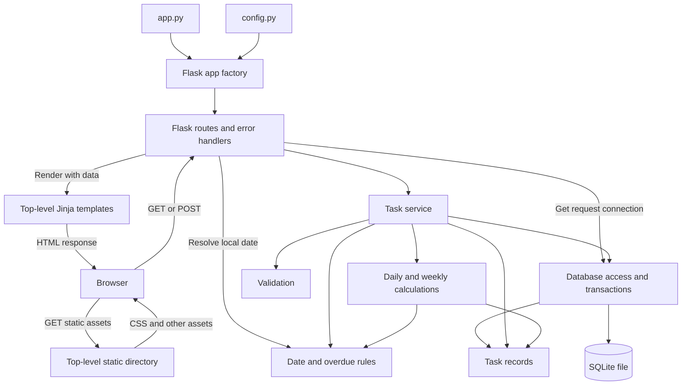
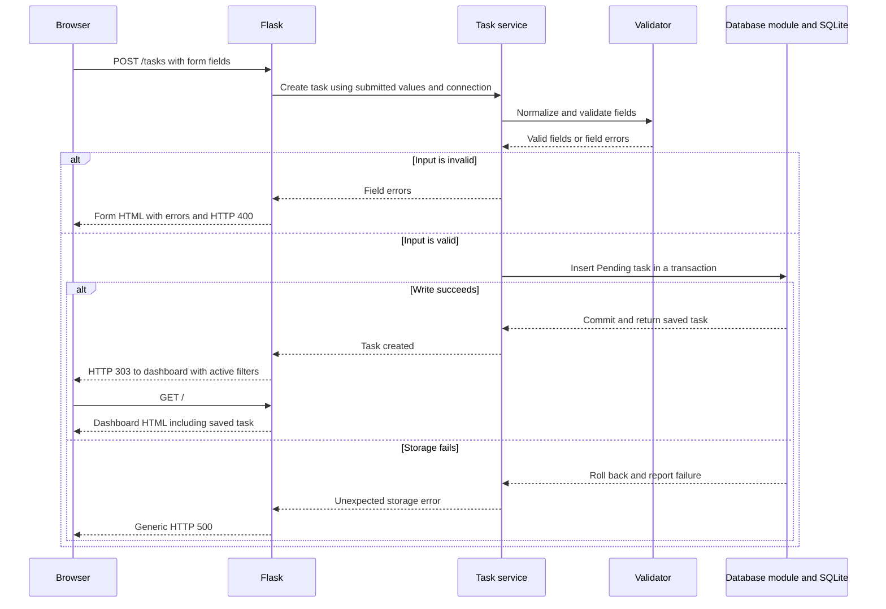
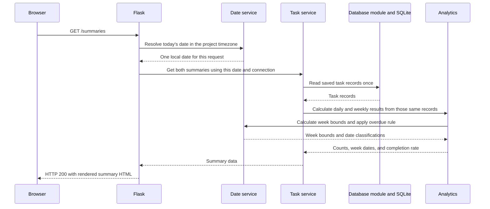

# DayPlan architecture

Daily Task and Reminder Manager · Phase 2

The behavior this architecture supports is defined in the [project specification](PROJECT_SPECIFICATION.md). The approved product rules are the baseline. The new routes and backend components are implementation plans.

| Status | Decisions |
|---|---|
| Existing | `app.py` exposes the app from the single factory in `dayplan/__init__.py`. The factory loads `config.py`, serves the top-level templates and static files, and registers the placeholder dashboard, health endpoint, and 404/500 handlers. Flask test-client coverage exists for these entry points. |
| Confirmed direction | Use Python 3.13, Flask, Jinja2, HTML/CSS, SQLite, pytest, and GitHub Actions. Preserve one app factory and the top-level `templates/` and `static/` directories. Keep task rules and authoritative date and summary calculations on the server. |
| Planned | Task routes, database access, validation, date and reporting logic, and their tests. The backend modules are scaffolds. CI is planned, and Render is optional. |

## 1. System architecture

DayPlan is a single Flask application. The browser submits ordinary HTML forms and receives HTML rendered with Jinja. Flask routes translate HTTP requests into service calls. Services coordinate task operations, and the persistence module is the only place that executes SQL. SQLite stores the task records in one file.

## 2. Startup and configuration

1. Flask or the deployment server imports `app.py`. It calls `create_app()` and exposes the returned application. Tests call the same factory with `TestingConfig`.
2. The factory builds the app, sets absolute paths to the existing top-level `templates/` and `static/`, loads the configuration, and registers routes and error handlers.
3. Add a `DATABASE_PATH` setting for the SQLite file, the `Asia/Kolkata` project timezone, the Flask `init-db` command, and app-context teardown. Resolve dates with `ZoneInfo` using the required `tzdata` dependency for portability. Register connection cleanup at setup and open a connection only when needed.
4. Development uses a database under the ignored `instance/` directory. Tests override the path with a fresh temporary database. If deployed, the host supplies a writable persistent database path and runs with debug mode off. Load Flask's `SECRET_KEY` from the environment in development, tests, and deployment before enabling task routes with flash messages. Tests set a separate test-only environment value before creating the app. A missing key must be reported before accepting a write through those routes.
5. Run `flask --app app init-db` before serving task routes against a new database. The command creates the directory and schema as needed and preserves rows on repeated runs. Normal requests require an initialized schema and surface a missing schema as a setup error. The Team Lead registers the command and teardown hook. Backend supplies schema initialization and connection helpers.

## 3. Module responsibilities and dependencies

The table distinguishes the existing entry points from the proposed roles of the empty backend modules.

| Module | Responsibility | Dependencies within DayPlan |
|---|---|---|
| `app.py` | Existing entry point. Expose the configured Flask app. | `dayplan.create_app` |
| `config.py` | Existing development and testing classes. Proposed home for database path and timezone settings. | None |
| `dayplan/__init__.py` | Existing factory and HTTP entry points. Register routes, handlers, and proposed database lifecycle hooks. | `config`, `task_service`, `date_service`, and `database` for connection setup and teardown |
| `dayplan/task_service.py` | Validate input through the validator, coordinate create/read/update/delete and completion, enforce transitions, and supply task lists and summary results. | `models`, `validators`, `date_service`, `database`, `analytics` |
| `dayplan/validators.py` | Normalize plain task and filter values and report field-specific errors. Return typed values such as dates and priorities. | `models` for shared status and priority definitions |
| `dayplan/models.py` | Define the plain Python task record and shared status and priority values. | None |
| `dayplan/database.py` | Own the schema, connection and transaction helpers, parameterized SQL, and mapping result rows to task records. | `models` |
| `dayplan/date_service.py` | Resolve the current local date from the configured timezone and calculate due-today, overdue, and week boundaries. | `models` for task fields and status where needed |
| `dayplan/analytics.py` | Calculate report counts and completion rates from task records and an explicit local date. | `models`, `date_service` |
| `tests/conftest.py` | Proposed home for shared fixtures such as the test app, client, and temporary database. | App factory, test configuration, database initialization |
| `tests/test_routes.py` | Existing Flask test-client tests. Expand coverage as routes are introduced. | App factory and test fixtures |
| `tests/test_tasks.py` | Proposed tests for task operations and state changes. Add focused test modules when useful for validation, date rules, and analytics. | Backend modules and test fixtures |

The entry point depends on the factory, the HTTP layer depends on the service, and the service depends on the modules that supply data and rules. Backend functions accept plain Python values and an explicit connection where they need one, so they can run without a Flask app or request context. They never import the factory, read form data, render templates, or choose an HTTP status. Analytics receives task records and never queries SQLite directly. Templates receive the values they need to display and do no business calculations.

## 4. Routes and communication

| Method and path | Responsibility | Status |
|---|---|---|
| `GET /` | Read filter query parameters, ask the service for matching tasks, and render the dashboard. | Existing placeholder, task integration planned |
| `GET /health` | Return the existing JSON liveness response. | Existing |
| `GET /static/<path:filename>` | Serve CSS and other assets from the top-level static directory. | Existing |
| `POST /tasks` | Read form fields, call create, and redirect to the dashboard after success. | Planned |
| `GET /tasks/<int:task_id>/edit` | Load the task and display its edit form. | Planned |
| `POST /tasks/<int:task_id>/edit` | Submit edited fields to the service and redirect after success. | Planned |
| `POST /tasks/<int:task_id>/complete` | Ask the service to mark the task completed. | Planned |
| `POST /tasks/<int:task_id>/delete` | Ask the service to remove the task after confirmation. | Planned |
| `GET /summaries` | Ask the service for daily and weekly results and render them together. | Planned |

Forms submit title, description, due date, and priority in the POST body. The server assigns the ID, status, and completion date. Status and priority navigation filters come only from the URL query. Apply both together and preserve them across task actions and 303 redirects. A validation failure returns 400 and re-renders the relevant form with its entered values and field messages. Identical edits leave the record and `updated_at` unchanged.

The route reads HTTP inputs, obtains the request's database connection when needed, and passes inputs and the same local date to the task service. It receives task records, display-ready indicators or summary values, or a known error. The route chooses the template, redirect, or response status. Jinja escapes user-entered text and displays the server-calculated values. A little browser scripting may help with interaction, such as deletion confirmation.

### Create a task

### View daily and weekly summaries

## 5. SQLite connection and transaction lifecycle

- Open at most one connection per Flask application context as needed, typically for one request. Store it in Flask's context-local `g` through the integration, and close it in the registered teardown callback on success or failure. A CLI command gets its own context. Pure service and database tests can use an explicit test connection.
- The task service decides which steps belong to one mutation. The database module provides the transaction boundary and owns SQL, commit, and rollback. Validate input before writing, make any state-dependent checks and their write within the same transaction, commit on success, and roll back on failure. Return success only after commit. Teardown closes the connection.
- Use parameterized SQL and enforce basic data integrity in SQLite, including unique IDs and approved status and priority values. Use `YYYY-MM-DD` for stored calendar dates and convert rows to Python dates at the persistence boundary. Keep the schema and initialization logic together.
- A summary request reads all saved tasks once and computes both reports from the same records. Navigation filters are only used for the back link. It uses a read-only operation without a write transaction. Start with Python aggregation over the small task list expected for this project.

## 6. Error-handling flow

| Outcome | Backend action | Flask response |
|---|---|---|
| Invalid task input or filter | Return structured field or filter errors. Leave saved values unchanged. | Re-render with feedback and preserve entered values. Use HTTP 400. |
| Unknown task ID | Report that the task was not found. | Use the 404 handler. |
| Unexpected database or application error | Roll back an open write transaction, then propagate the failure for server-side logging. | Use the generic 500 handler. Keep SQL, tracebacks, and private settings out of the user response. |
| Successful change | Commit and return the saved result. | Redirect to a GET page. |

## 7. Dates and summaries

The date service resolves the project-local date once per request. Pass that date explicitly into calculations so unit tests can supply a fixed day. A task is overdue only when it is Pending and its due date is before that day. Equality means due today. Completed and undated tasks never count as overdue. Persist Pending and Completed as task states and derive overdue and due-today indicators when reading tasks. The actionable due-today list includes only Pending tasks. The daily due total includes both statuses.

Analytics counts tasks due today by status, overdue tasks, and tasks completed today using the recorded local completion date. The latter measure can overlap with the due-today count. For the weekly summary, the date service returns the Monday–Sunday bounds and analytics counts the tasks due within those inclusive dates. The rate is **completed tasks due in the week ÷ all tasks due in the week × 100**. A week with no tasks due has no rate and the template displays “No tasks due,” even if undated or out-of-week tasks exist. A nonempty week with no completions shows 0.0%. The template may format the result for display.

## 8. Testing and continuous integration

| Test layer | What it verifies |
|---|---|
| Unit | Validators and date and analytics functions using supplied records and a fixed date. Cover invalid input, length boundaries, leap dates, due yesterday, today, or tomorrow, old due dates on Completed tasks, Asia/Kolkata midnight, Monday/Sunday, weeks crossing years, an empty database, and tasks outside an empty week. |
| SQLite integration | A freshly initialized temporary database per test. Verify create, edit, complete, delete, editing Completed tasks, identical edits preserving `updated_at`, persistence after reopening the connection, and rollback on failure. |
| Flask integration | Build the app with test configuration and use the Flask test client without a live server. Cover empty titles, invalid priorities and dates, preserved form values, URL and form priority separation, combined filters, 303 filter preservation, summary independence, flash messages, static files, and 404/500 responses. |

The proposed GitHub Actions workflow in `.github/workflows/` installs pinned dependencies on Python 3.13 and runs `python -m pytest` on pushes and pull requests. Establish the workflow in a reviewed PR and verify the named pytest job runs before configuring it as required on protected `main`. Require reviewed PRs and a successful check before merging feature work. The team lead owns the workflow and route tests, the backend owner covers logic and persistence, and the frontend owner verifies the rendered behavior and keyboard use.

## 9. Deployment

The baseline is a local demo. It uses the existing Flask entry point and a SQLite file under `instance/`. If the team chooses optional hosting, evaluate Render with one web service exposing the existing `app:app` through a production WSGI server, debug mode off, and the SQLite path configured separately. Initialize the schema at runtime on the mounted persistent storage and use `/health` as a liveness check. It confirms the process responds. A hosted demo smoke test should separately verify that a task persists across both a restart and a redeploy.

Approve the host's persistent storage and demo access before deploying a mutable task list. If the team cannot verify persistence and appropriate access, use the local demo and document the hosting constraint. Record the approved setup, initialization, test and run commands, demo or screenshots, and limitations in the README.

## 10. Implementation handoffs

- Verify timezone loading in Windows and CI after installing the pinned dependencies. Keep tests deterministic by passing a fixed local date or clock.
- Use the [API contract](API_CONTRACT.md) as the handoff for endpoint names, form fields, service results, and error data. The team can confirm list order and deletion confirmation presentation during implementation.
- For optional Render hosting, agree on access, form protection, runtime database initialization, and demo data before deployment.
